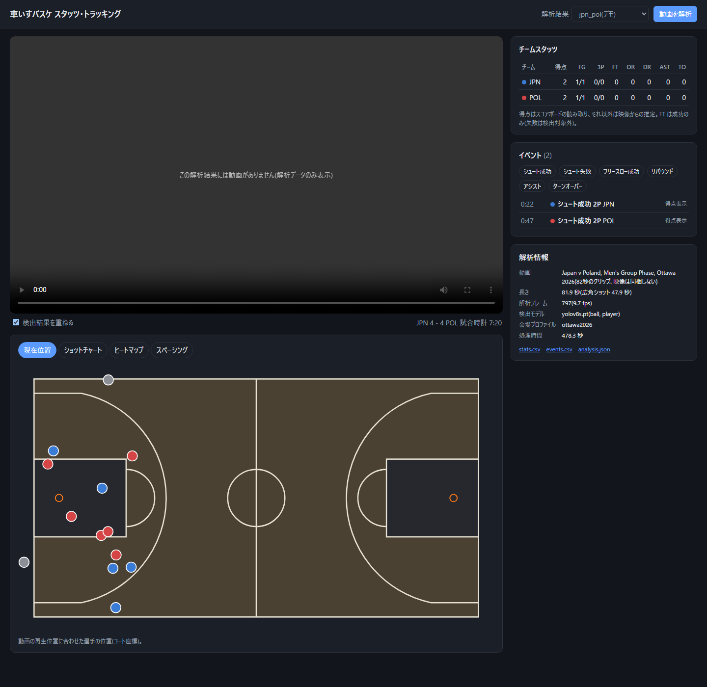
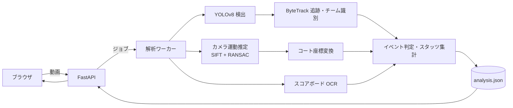

# 車いすバスケ スタッツ・トラッキング解析

車いすバスケットボールの**中継映像**から、選手・ボールを検出・追跡し、
**基本スタッツ(得点・シュート・リバウンド・アシスト・ターンオーバー)の自動検出**、
**選手位置のコート座標への変換**、**ハーフコートのスペーシング可視化**までを行う Web アプリです。



## できること

| 機能 | 内容 | 現状 |
|---|---|---|
| 広角ショットの判定 | 中継映像から、コート全体を映すメインカメラの区間だけを取り出す(クローズアップ・別アングル・リプレイを除外) | 動作(42フレームの目視確認ですべて正しく分類) |
| 選手の検出・追跡・チーム識別 | YOLOv8 + ByteTrack、ユニフォーム色と箱の形(座っている選手 / 立っている審判)でチームを判定 | 動作 |
| コート座標変換 | パン・ズームする中継カメラでも、フレームごとに選手の位置をコート座標(m)に変換 | 動作(未校正フレームでの誤差 平均 0.13m / 最大 0.30m) |
| 得点の検出 | スコアボードを OCR で読み、得点の変化から成功シュート・フリースローを検出 | 動作 |
| シュート試投・リバウンド・アシスト・ターンオーバー | ボール保持者の推定と、ボールとリングの位置関係からルールで判定 | ロジック・テストは実装済み。既製モデルではボール検出が不足しており、**自前データでの学習待ち** |
| スペーシング | 攻撃側選手の凸包面積・選手間距離、位置のヒートマップ | 動作(攻撃区間の判定はボール保持に依存) |
| Web アプリ | 動画のアップロード → 解析ジョブ → スタッツ表・イベント一覧(クリックで該当シーン再生)・コート図 | 動作 |

## 構成



- 設計: [docs/design.md](docs/design.md)、開発計画と進捗: [docs/plan.md](docs/plan.md)

## 技術的なポイント

### 1. 中継カメラの動的ホモグラフィ(カメラキャリブレーション)
中継のメインカメラは位置を固定したまま向きとズームだけを変えるため、2枚の画像の対応は奥行きによらず1つのホモグラフィで表せる。
これを利用し、会場ごとに3枚のキーフレームだけを校正して、各フレームはキーフレームとの特徴点照合(SIFT + RANSAC)で位置合わせする。
コート中央のようにラインの交点が見えない場所は「サイドライン上にある」という線上の拘束で校正した。
位置合わせの成否をそのまま「広角ショットかどうか」の判定に使っている。→ [docs/05_homography.md](docs/05_homography.md)

### 2. 車いすバスケ特有の検出の問題
既製の COCO モデルは、座っている選手に対して上半身だけの箱と車いすを含む箱を重ねて出す、車輪が箱から外れる、ベンチの選手と区別できない、
広角ショットのボールをほとんど検出できない(25枚中2〜4枚)、といった問題があった。
→ [docs/01_baseline_yolov8.md](docs/01_baseline_yolov8.md)。「選手+車いす全体」を1つの箱とする自前データセットの設計: [docs/annotation_guide.md](docs/annotation_guide.md)

### 3. 映像だけに頼らないスタッツ
得点はスコアボードの OCR から取る。OCR の誤読は「得点は減らない」「時計は経過時間どおりに進むか止まっている」という時間方向の整合性で補正する
(Tesseract が 7 を 1 と読む誤りは、両方の候補から時間的に整合する方を選ぶ)。

## 使い方

```bash
# 環境構築(Python 3.11)
python -m venv .venv && .venv/Scripts/activate      # Linux/macOS: source .venv/bin/activate
pip install torch torchvision --index-url https://download.pytorch.org/whl/cpu
pip install -e ".[api,dev]"
# スコアボード OCR に Tesseract が必要(Windows: UB Mannheim 版のインストーラ、Ubuntu: apt install tesseract-ocr)

# 動画を解析(analysis.json, stats.csv, events.csv を出力)
python scripts/analyze.py <video.mp4> --profile ottawa2026 --out runs/analysis/game1

# Web アプリ
uvicorn wbt.api.app:create_app --factory --port 8000        # → http://localhost:8000

# テスト
pytest
```

- 新しい会場の映像を解析するには、会場プロファイル(キーフレームの校正)を作る: `scripts/calibrate_keyframe.py`
- Docker・公開環境: [docs/deploy.md](docs/deploy.md)
- 自前データセットの作成と学習: [docs/annotation_guide.md](docs/annotation_guide.md)、`scripts/prepare_dataset.py`、`notebooks/01_train_detector.ipynb`

## ディレクトリ構成

```
src/wbt/          解析パイプライン(検出・追跡・カメラ・OCR・イベント・評価)と API
scripts/          CLI(解析、校正、データセット作成、評価)
web/              フロントエンド(ビルド不要の HTML/CSS/JS)
profiles/         会場プロファイル(スコアボード位置、キーフレーム校正)
demo/             同梱デモの解析結果(映像は含まない)
notebooks/        Colab での学習
docs/             設計・計画・検証記録
tests/            単体テスト・API テスト
```

## 制約と今後

- ボール検出が既製モデルでは不足しているため、映像からのシュート試投・リバウンド・アシスト・ターンオーバーの判定は、自前データで学習したモデルに差し替えてから評価する(計画: [docs/plan.md](docs/plan.md) P2b)
- 選手の個人識別(背番号の認識)はスコープ外。スタッツはチーム単位
- 会場ごとのキーフレーム校正は手作業(1会場3枚)
- 試合映像そのものはリポジトリに含めない

## ライセンス

検出に使用している [ultralytics](https://github.com/ultralytics/ultralytics) は AGPL-3.0 です。
