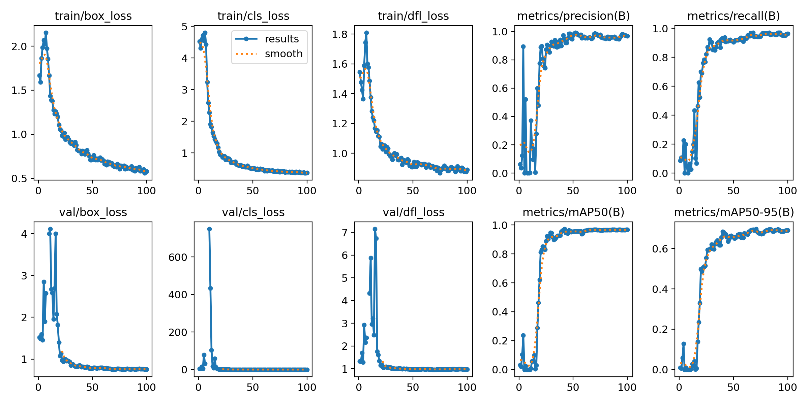
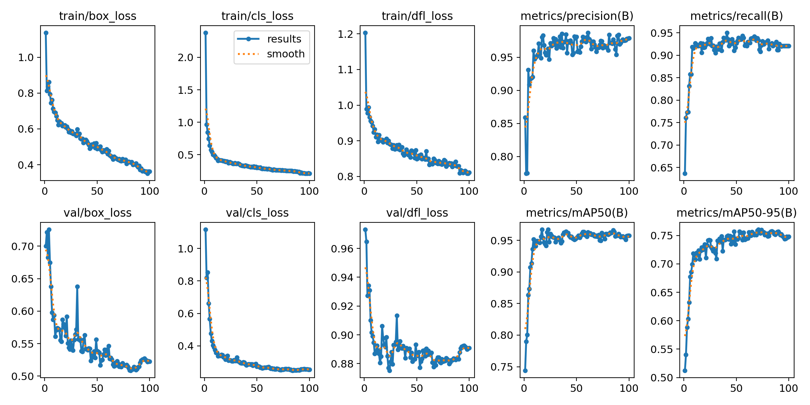

# 03. ファインチューニングと評価

最終更新: 2026-10-17

## 1回目(100 枚)

### 学習条件

- ベースモデル: yolov8s(COCO 学習済み)
- データ: train 60 枚(3 試合)/ val 20 枚(Canada v USA)/ test 20 枚(USA v Japan)。分割は試合単位(`docs/02_dataset.md`)
- imgsz 1280、100 エポック、batch 8、cos_lr、左右反転あり・上下反転なし
- Google Colab(T4)、`notebooks/01_train_detector.ipynb`

### 学習曲線

- 最初の 20 エポックほどは不安定(学習率のウォームアップ中で、データも少ないため)。50 エポック付近で収束し、val の mAP50 は約 0.97、mAP50-95 は約 0.69 で頭打ち
- val の損失は学習の損失とともに下がった後に横ばいで、過学習の兆候はない

### test セットでの評価

`python scripts/eval_detector.py data/dataset/yolo --split test --weights yolov8s.pt yolov8x.pt models/batch1.pt`
(既製モデルは person → player、sports ball → ball に読み替えて、同じ方法で計算。結果は `docs/results/detector_eval_batch1.json`)

| クラス | 既製 yolov8s | 既製 yolov8x | **自前 batch1(yolov8s)** | 正解の数 |
|---|---|---|---|---|
| player AP50 | 0.244 | 0.279 | **0.950** | 174 |
| player AP50-95 | 0.087 | 0.114 | **0.767** | |
| ball AP50 | 0.004 | 0.188 | **0.963** | 16 |
| ball AP50-95 | 0.003 | 0.094 | **0.417** | |
| rim AP50 | – | – | **1.000** | 18 |
| referee AP50 | – | – | **0.958** | 49 |

### 考察

- **player**: 既製モデルの AP が低いのは、主に箱の定義の違い(既製モデルは上半身だけを囲むことが多く、IoU 0.5 に届かない)と、ベンチ・観客を player として出すことによる。「選手+車いす全体」を1つの箱とする定義で学習したことで、接地点(コート座標変換に使う)まで含む箱が出るようになった
- **ball**: 既製の yolov8s ではほぼ検出できなかった(広角ショットで直径 40px 前後)。60 枚の学習で AP50 0.96 まで上がった。AP50-95 が 0.42 にとどまるのは、小さい物体では数 px のずれで IoU が大きく下がるため
- **注意**: test セットは 1 試合・20 枚(ボール 16 個)と小さく、数値のばらつきが大きい。また test の試合は学習データと同じ会場の中継で、別会場への汎化はこの評価では測れていない。2回目(合計 300 枚)で test を増やして評価し直す

## 2回目(合計 300 枚)

### 学習条件

1回目と同じ(yolov8s から学習、imgsz 1280、100 エポック)。データは train 180 / val 60 / test 60 枚。

- 10 エポック程度で mAP50 が 0.95 前後に達し、mAP50-95 は 70 エポック付近で約 0.75 に達して頭打ち。1回目(約 0.69)より高い
- 終盤(80 エポック以降)に val の dfl_loss がわずかに上がり始めており、軽い過学習の兆候がある。`best.pt` は val の成績が最も良いエポックの重みなので、影響は小さい

### test セットでの評価と、評価データの偏り

test 60 枚全体では、1回目と2回目のモデルの差はほとんど見えなかった(`docs/results/detector_eval_batch2.json`):

| クラス(AP50 / AP50-95) | 既製 yolov8s | 1回目 | 2回目 |
|---|---|---|---|
| player | 0.235 / 0.087 | 0.977 / 0.894 | 0.975 / 0.882 |
| ball | 0.118 / 0.084 | 0.770 / 0.557 | 0.819 / 0.493 |
| rim | – | 0.981 / 0.797 | 0.981 / 0.729 |
| referee | – | 0.960 / 0.890 | 0.953 / 0.845 |

しかし、test 60 枚のうち 40 枚(2回目に追加した分)は**1回目のモデルが下書きを作り、その箱の 97% がそのまま正解として残っている**。
正解が1回目のモデルの出力に寄っているため、1回目のモデルに有利な評価になっている。下書きの出どころ別に分けて評価した(`docs/results/detector_eval_batch2_by_draft.json`):

| test の内訳 | モデル | player | ball | rim | referee |
|---|---|---|---|---|---|
| **既製モデルが下書き(20 枚)** | 1回目 | 0.950 / 0.767 | 0.963 / 0.417 | 1.000 / 0.582 | 0.958 / 0.834 |
| | **2回目** | **0.958 / 0.794** | **0.989 / 0.469** | **1.000 / 0.600** | 0.957 / **0.852** |
| 1回目のモデルが下書き(40 枚) | 1回目 | 0.992 / 0.982 | 0.674 / 0.659 | 0.972 / 0.964 | 0.961 / 0.926 |
| | 2回目 | 0.987 / 0.937 | 0.734 / 0.520 | 0.972 / 0.817 | 0.952 / 0.847 |

- 1回目のモデルが下書きした 40 枚では、1回目のモデルの player AP50-95 が 0.98 と不自然に高い(正解の箱がほぼ自分の出力そのもの)
- 偏りのない 20 枚では、**2回目のモデルが全クラスで1回目を上回った**
- 1回目のモデルが下書きした 40 枚のボールは AP50 が両モデルとも低い(0.67 / 0.73)。これは、1回目のモデルが見落とし、人が追加したボール(=難しい例)が多いため。2回目のモデルの方が多く拾えている

**教訓**: 比較対象のモデルに test の下書きを作らせると、評価がそのモデルに有利に偏る。
モデルの支援でアノテーションを効率化する場合でも、test セットは比較対象と無関係な方法(既製モデルの下書き、または下書きなし)で作る必要がある。
今後 test を増やすときは、既製モデルで下書きを作るか、下書きなしで付ける。

### まとめ

| | 既製 yolov8s | 2回目(自前 300 枚) |
|---|---|---|
| player AP50(偏りのない test 20 枚) | 0.244 | **0.958** |
| ball AP50(同上) | 0.004 | **0.989** |

現時点の採用モデルは `models/batch2_s.pt`(解析パイプラインの `--weights` に指定する)。
