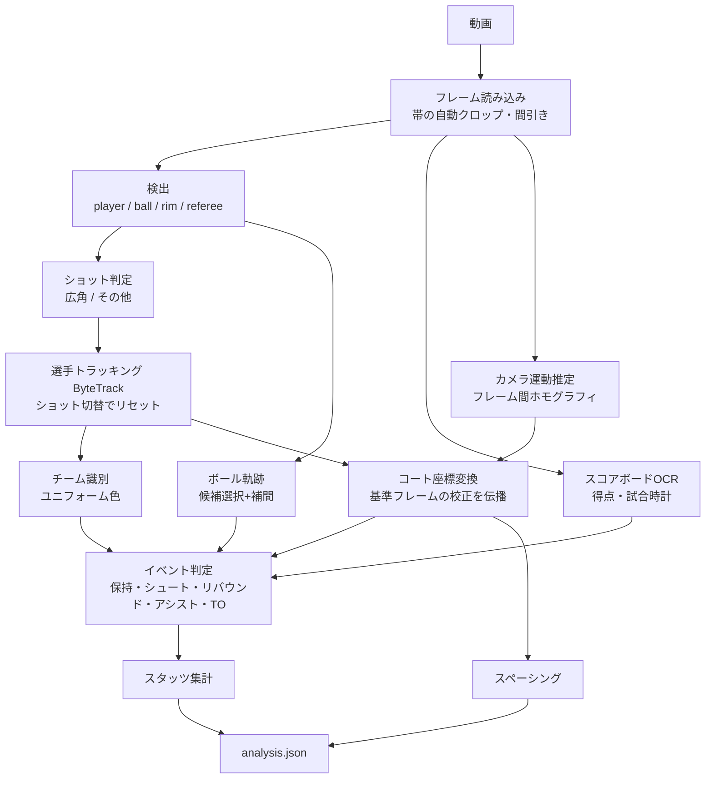

# 外部設計

最終更新: 2026-09-26

## 1. システム構成

```mermaid
flowchart LR
  U[ブラウザ] -- 動画アップロード --> API[FastAPI]
  API -- ジョブ投入 --> W[解析ワーカー<br/>別プロセス]
  W --> P[解析パイプライン<br/>wbt.pipeline]
  P -- analysis.json --> S[(ジョブ保存領域<br/>storage/jobs/{id})]
  API -- 結果・動画配信 --> U
  PR[(会場プロファイル<br/>profiles/*.json)] --> P
  M[(検出モデル<br/>COCO or 自前学習)] --> P
```

- ブラウザから動画をアップロードすると解析ジョブが作られ、ワーカープロセスが1件ずつ処理する(CPU推論で数分〜数十分かかるため非同期)
- 解析結果は1つの JSON(`analysis.json`)にまとめ、フロントエンドはそれだけを読んで表示する
- 解析済みのデモ試合を `storage/demo/` に置き、閲覧者が解析を待たずに見られるようにする

## 2. 解析パイプライン



| モジュール | 役割 | 主な手法 |
|---|---|---|
| `wbt.video` | フレーム読み込み、帯の自動クロップ、間引き | OpenCV |
| `wbt.detect` | 物体検出。モデルごとのクラス対応表で `player/ball/rim/referee` に正規化する | YOLOv8(ultralytics) |
| `wbt.camera` | カメラ運動推定、広角ショットの判定、画像座標↔コート座標の変換 | SIFT 特徴点+RANSAC ホモグラフィ。キーフレームに照合できたフレームを広角ショットとする |
| `wbt.calibration` | キーフレームの校正 | 点の対応+ライン上の拘束の最小二乗 |
| `wbt.shots` | 広角ショットの簡易判定(校正前の会場の映像、データセット作成用) | 人物の箱の大きさ・数によるルール |
| `wbt.tracking` | 選手の追跡、ボール軌跡の選択と補間 | ByteTrack、最近傍+線形補間 |
| `wbt.teams` | 選手のチーム識別 | 箱の縦横比で立っている人物(審判等)を除き、床の画素を除いた胴体の色を k-means(k=2)、トラック単位の多数決 |
| `wbt.scoreboard` | 得点・試合時計の読み取り | Tesseract OCR+時間方向の整合チェック(得点は減らない、時計は経過時間と整合する候補を選ぶ) |
| `wbt.dataset` / `wbt.evaluate` | データセット作成(下書きラベル、CVAT 連携、試合単位の分割)、検出・イベントの評価 | – |
| `wbt.events` | ボール保持の推定とイベント判定 | ルールベース |
| `wbt.stats` / `wbt.spacing` | 集計、スペーシング指標 | – |
| `wbt.pipeline` | 上記の実行順制御、進捗通知、`analysis.json` の出力 | – |

### 2.1 コート座標変換の方式(動的ホモグラフィ)

放送用の広角カメラは、位置を固定したままパン・チルト・ズームする。カメラ中心が動かない場合、2フレーム間の画像の対応は奥行きに関係なく1つのホモグラフィで表せる(回転のみのカメラモデル)。これを利用して次のように変換する。

1. 会場ごとに基準フレーム(キーフレーム)を数枚選び(左右のゴール付近とコート中央)、コート上の既知点(ペイントエリアの角など)とライン上の点(サイドラインの縁など)の画像座標を指定して、コート平面→キーフレームのホモグラフィを求める。リングの画像座標もキーフレームで指定する。詳細と精度は `docs/05_homography.md`
2. 各フレームについて、基準フレームとの間のホモグラフィ `G_t`(フレーム t → 基準フレーム)を推定する。隣接フレーム間の推定を連鎖させ、ドリフトを抑えるため一定間隔とショット切替時に基準フレームへ直接照合し直す
3. 選手の接地点(箱の下端中央)を `H_ref · G_t` でコート座標に変換する。リングは `G_t^-1` で各フレームの画像座標に写す(リングは床面上にないが、回転のみのカメラモデルなら画像間の対応として成り立つ)
4. 特徴点は選手の箱とスコアボードの領域を除いて抽出する(動く物体に引きずられないように)

基準フレームの特徴点と校正点は会場プロファイルに保存し、同じ会場・同じ中継カメラの試合で使い回す。

### 2.2 イベント判定のルール

| イベント | 判定方法 | 根拠データ |
|---|---|---|
| 得点(成功シュート、フリースロー) | スコアボードの得点が増えた時刻・チーム・増分(1=FT、2=2P、3=3P) | OCR |
| ボール保持 | ボールが選手の箱の上半分付近に一定フレーム以上あり続ける | ボール軌跡、選手トラック |
| シュート試投 | 保持が解けた直後、ボールが上向きに移動しながらリングへ近づく | ボール軌跡、リング位置 |
| シュート失敗 | 試投後、一定時間内に得点変化がない | 試投、OCR |
| リバウンド | シュート失敗後に最初に保持したチーム。シュートと同じチームならオフェンスリバウンド | 保持、チーム |
| アシスト | 成功シュートの直前(3秒以内)に、同じチームの別の選手からボールを受けていた | 保持の遷移、チーム |
| ターンオーバー | シュート試投を挟まずに保持チームが相手に変わった | 保持、チーム |

- 選手の個人識別(背番号の認識)はスコープ外。スタッツはチーム単位で集計し、イベントには画面上のトラックIDを参考情報として付ける
- 各イベントには `source`(`scoreboard` / `vision`)と `confidence` を付け、どの根拠で判定したかを追えるようにする

## 3. データ形式

### 3.1 会場プロファイル(`profiles/<name>.json`)

```json
{
  "name": "ottawa2026",
  "frame_size": [1920, 1080],
  "scoreboard": {
    "score_a": [910, 980, 972, 1025],
    "score_b": [978, 980, 1040, 1025],
    "clock": [1345, 980, 1415, 1025],
    "overlay": [580, 965, 1490, 1060]
  },
  "teams": {"a": {"name": "JPN", "color": [235, 235, 235]}, "b": {"name": "POL", "color": [200, 30, 40]}},
  "keyframes": [
    {"name": "left", "points": [[img_x, img_y, X, Y], [img_x, img_y, null, -7.5], ...],
     "rims": [[x, y]], "features": "ottawa2026_left.npz", "H_court": [[...], [...], [...]],
     "calibration": {"point_err_px_mean": 4.0, "line_err_m_max": 0.04}}
  ]
}
```

- `points` の X / Y の一方が `null` の点は「その直線上にある」という拘束(例: `null, -7.5` は奥のサイドライン上)
- `overlay` はスコアボード全体の領域。特徴点抽出から除外する

- ROI は帯クロップ後の 1920x1080 座標。`teams.color` はチーム識別のクラスタをチーム名に対応付けるために使う(試合ごとに変わるため、実運用ではアップロード時に指定する)
- コート座標系: 原点をコート中心、X 軸を長辺方向(±14m)、Y 軸を短辺方向(±7.5m)、単位はメートル(FIBA規格 28m×15m)

### 3.2 解析結果(`analysis.json`)

```json
{
  "version": 1,
  "meta": {"video": "...", "fps": 29.18, "stride": 3, "n_frames": 2390, "duration": 81.9,
           "crop": [0, 60, 1920, 1140], "model": "yolov8s.pt", "profile": "ottawa2026"},
  "teams": [{"id": "a", "name": "JPN", "color": [230, 230, 230]}, {"id": "b", "name": "POL", "color": [200, 30, 40]}],
  "segments": [{"start": 0.0, "end": 11.2, "type": "wide"}],
  "frames": [
    {"t": 0.10, "wide": true,
     "players": [{"id": 3, "team": "a", "box": [x1, y1, x2, y2], "court": [X, Y]}],
     "ball": {"xy": [x, y], "court": null, "interpolated": false},
     "possession": {"team": "a", "player": 3}}
  ],
  "scoreboard": [{"t": 0.0, "score_a": 2, "score_b": 4, "clock": "7:50"}],
  "events": [
    {"id": 1, "type": "made_shot", "t": 23.1, "team": "a", "player": 7, "points": 2,
     "source": "scoreboard", "confidence": 0.95, "related": []}
  ],
  "stats": {"a": {"PTS": 2, "FGM": 1, "FGA": 3, "3PM": 0, "3PA": 0, "FTM": 0, "FTA": 0,
                  "OREB": 0, "DREB": 1, "AST": 0, "TOV": 1}},
  "possessions": [{"start": 12.0, "end": 30.5, "team": "a", "half_court": true,
                   "spacing": {"hull_area_m2": 41.2, "mean_pair_dist_m": 5.8}}]
}
```

- `frames` は解析した(間引き後の)フレームのみ。広角ショットのフレームには、そのフレームでのリング位置 `rims`、キーフレームに対する拡大率 `zoom`、照合したキーフレーム名 `keyframe` も入る
- `meta.frame_size` は解析座標系の大きさ。フロントエンドは `meta.crop`(元動画での映像領域)と合わせて、元動画上に検出結果を重ねる
- `event.type`: `made_shot` / `missed_shot` / `free_throw` / `rebound` / `assist` / `turnover`。`rebound` は `details.offensive` を持つ

## 4. API

| メソッド | パス | 内容 |
|---|---|---|
| POST | `/api/jobs` | multipart で動画(と任意でプロファイル名)を受け取り、ジョブを作成。`{"id": "..."}` を返す |
| GET | `/api/jobs` | ジョブ一覧(デモを含む) |
| GET | `/api/jobs/{id}` | 状態 `queued / running / done / failed`、進捗(0〜1)、現在の処理段階 |
| GET | `/api/jobs/{id}/analysis` | `analysis.json` |
| GET | `/api/jobs/{id}/video` | 解析対象の動画(Range リクエスト対応、シーン再生用) |
| GET | `/api/profiles` | 利用可能な会場プロファイル |

- ジョブの状態は `storage/jobs/{id}/status.json` にファイルで保持する(DBは使わない。単一サーバー・少数ジョブ前提のため)
- ワーカーは API と同じコンテナ内の別プロセス(`multiprocessing`)で1件ずつ処理する

## 5. 画面設計

1画面構成(SPA)。

```
┌──────────────────────────────────────────────┐
│ ヘッダー: タイトル / ジョブ選択 / アップロード   │
├───────────────────────┬──────────────────────┤
│ 動画プレーヤー          │ スタッツ表(チーム別)   │
│ (検出結果のオーバーレイ │  PTS FGM/FGA REB AST TO │
│  ON/OFF)               ├──────────────────────┤
│                       │ イベント一覧           │
│                       │  時刻・種別・チーム    │
│                       │  クリックで該当シーンへ │
├───────────────────────┴──────────────────────┤
│ コート図: [ショットチャート|ヒートマップ|スペーシング|現在位置] タブ │
└──────────────────────────────────────────────┘
```

- アップロード中・解析中は進捗バーと処理段階を表示する
- 動画の再生位置に合わせて、コート図の「現在位置」タブに選手位置をリアルタイム表示する

## 6. 技術スタックと選定理由

| 対象 | 選定 | 理由 |
|---|---|---|
| 検出 | YOLOv8(ultralytics) | 学習・評価・トラッキング(ByteTrack)までが1つのライブラリで揃い、自前データでの学習から推論までの流れを短く保てる |
| OCR | Tesseract(pytesseract) | スコアボードは固定位置・大きな数字で、軽量な汎用OCRで十分読める(事前検証で得点はほぼ正読)。深層学習OCRより依存が軽い |
| カメラ運動推定 | OpenCV(ORB/SIFT+RANSAC) | 回転のみのカメラモデルで特徴点ベースの推定が理論的に成り立つ。ロボティクス側での画像位置合わせの知見を活かせる |
| API | FastAPI | 型付きのリクエスト/レスポンス、自動ドキュメント、Pythonのパイプラインと同一言語 |
| ジョブ管理 | ファイル+multiprocessing | 単一サーバー・少数ジョブ前提。Redis/Celery 等は現段階では過剰 |
| フロントエンド | 素の HTML/CSS/JavaScript(ビルドなし) | CV職向けポートフォリオのため、重心はパイプライン側に置く。ビルド工程をなくし、Dockerイメージと運用を単純に保つ |
| 可視化 | Canvas / SVG を自前描画 | コート図・ヒートマップは描画対象が限られ、ライブラリ依存を増やすほどではない |
| 配布 | Docker(python:3.11-slim+CPU版torch+tesseract) | CPUのみのクラウドでも動く構成にする |

## 7. 入力動画の方針

- **アップロードのみ対応し、YouTube URL からの取得機能は実装しない。** YouTube の利用規約は、YouTube が明示的に許可した方法以外での動画のダウンロードを禁じているため。ロードマップの「動画アップロードまたはYouTube URL指定」のうち、アップロード側で要件を満たす
- 公開デモでは、解析済みの結果(`analysis.json`)と、権利上問題のない範囲の短いクリップのみを扱う。試合映像そのものや学習用フレームは公開リポジトリに含めない

## 変更履歴

| 日付 | 変更内容 | 理由 |
|---|---|---|
| 2026-09-26 | 初版作成 | |
| 2026-09-26 | 広角ショットの判定を「箱の大きさのルール」から「キーフレームに照合できたか」に変更。スコアボードが消えている区間(リプレイ等)も除外。箱の大きさのルールは `wbt.shots` としてデータセット作成用に残した | 照合の成否でサイドラインカメラ・クローズアップをすべて正しく除外できた(42枚で確認)。箱の大きさのルールはサイドラインカメラを取りこぼした |
| 2026-09-26 | キーフレームを2枚→3枚(コート中央を追加)にし、校正にライン上の拘束を追加(`wbt.calibration`)。会場プロファイルの形式を変更 | 片側に偏った4点の校正では、コート中央で約140pxずれた。コート中央はラインの交点が見えにくいため、サイドライン上の拘束で補った |
| 2026-09-26 | チーム識別を k=3 から「縦横比で審判等を除く+k=2」に変更。胴体の色から床の画素を除くようにした | k=3 では赤いユニフォームの選手が白チームや「その他」に割り当てられた。床の画素が胴体の色に混ざっていたこと、審判(立っている)と選手(座っている)は箱の形で区別できることが分かった |
| 2026-09-26 | 検出後に「別の大きな箱にほぼ含まれる箱」を除く処理を追加 | COCO モデルが同じ選手に上半身の箱と全身の箱を重ねて出し、1人に2つのトラックが付いていた |
| 2026-09-26 | 同梱デモ(`demo/`、映像なし・解析結果のみ)を API のデモ一覧に含めるようにした | 公開環境で試合映像を配布せずにデモを見せるため |
